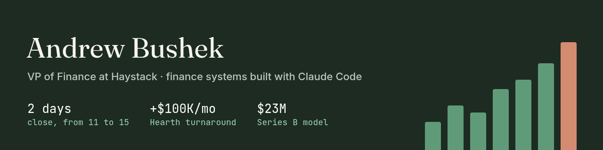

### Andrew Bushek

I run finance operations and write the software behind them, so I spend my time on strategy, not spreadsheets.

I am VP of Finance at [Haystack](https://www.haystackteam.com) - the whole finance team at a PE-backed B2B SaaS company. I built the finance tools with Claude Code.

- [Portfolio site](https://andrewbushek.github.io) has the dashboards and my background.
- [Finance portfolio](https://github.com/andrewbushek/portfolio) has walkthroughs of AR aging, a 13-week cash forecast, LTV/CAC working papers, and team planning with an MCP assistant.
- [Household finance demo](https://github.com/andrewbushek/household-finance-demo) is a browser-only app for shared expenses, income-based splits, and multi-currency trips.

All demo data is fictional. Day-to-day Haystack work is on [@andrewbushek-blip](https://github.com/andrewbushek-blip).

[LinkedIn](https://www.linkedin.com/in/andrewbushek) · andrewbushek@gmail.com
